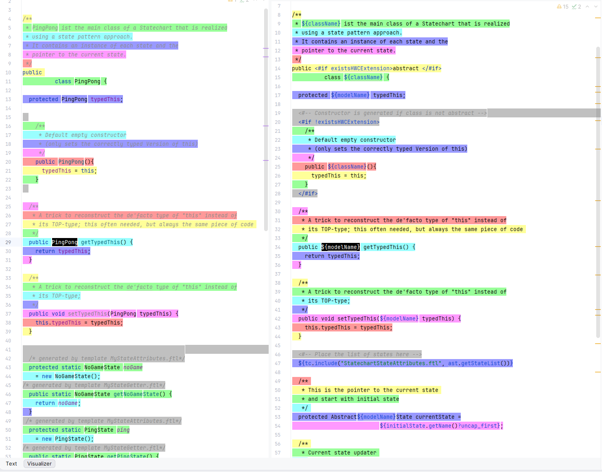

<!-- (c) https://github.com/MontiCore/monticore -->

# Source Map support in MontiCore

## What are Source Maps?
Source Maps are standardized data structures used to map generated or
transpiled code back to its original source files. Defined by
[ECMA-426](https://ecma-international.org/publications-and-standards/standards/ecma-426/),
a Source Map is a JSON-backed file containing:
- Name of the generated file
- References to original source files (`sources`)
- Embedded source contents (`sourcesContent`, optional)
- Compact, delta-encoded mappings between source and target positions 
using Base64 Variable-Length Quantity (VLQ) encoding

Source maps can be viewed in most modern IDEs or [online](https://sokra.github.io/source-map-visualization/).
The following shows an example visualization in IntelliJ IDEA:


## Source Maps in MontiCore

MontiCore uses template-based code generation to translate models into
target code.

During generation, MontiCore can produce two distinct source maps and an
include hierarchy map for every generated file:
1. **Template Source Map** (`<file>.map`): Maps generated code back to the 
lines and columns of the originating template.
2. **AST Source Map** (`<file>_AST.map`): Maps generated code back to the 
original DSL model and the corresponding AST node positions.
3. **Include Map** (`<file>.incl.json`): Traces the dynamic template and 
HookPoint inclusion hierarchy.


## How to enable Source Maps

Source map generation is integrated into MontiCore's reporting infrastructure.
To enable source maps, instantiate and register a `TemplateSourceMappingReporter`
with the `ReportManager`:

```diff
ReportManager reportManager = ...
...
+ TemplateSourceMappingReporter sourceMappingReporter = new TemplateSourceMappingReporter(SOURCE_MAP_TARGET, true);
...
+ reportManager.addReportEventHandler(sourceMappingReporter);
```

### Configuration Options
- `path`: The path where the `.map` and `.incl.json` files are 
written to. Best practice is to set this to the same directory as the 
generated files.
- `addContent`: When set to `true`, the full text of the referenced templates
and DSL models is embedded directly in the source map. This allows tools to
visualize source maps without needing direct access to the original template.

## Config Templates

Often one or more templates are used to act as generator orchestrators. As they do
not directly produce content for the target file, they should be excluded from
the source map generation process. In order to exclude them, such templates must
be registered:

```diff
+ Reporting.addConfigTemplate("<configTemplate>");
```

## Generated Artifacts

### Template Source Maps (`<file>.map`)

Template source maps trace which template directive or text block produced 
each segment of generated code.

Example: `PingPong.java.map`
```json
{
    "version": 3,
    "file": "C:\\repos\\monticore\\monticore-test\\01.experiments\\hooks\\target\\statepattern\\PingPong.java",
    "sourceRoot": "",
    "sources": [
        "file:/C:/repos/monticore/monticore-test/01.experiments/hooks/src/main/resources/MyStateAttributes.ftl",
        "file:/C:/repos/monticore/monticore-test/01.experiments/hooks/src/main/resources/MyStateGetter.ftl",
        "jar:file:/C:/repos/monticore/monticore-test/01.experiments/templates/target/libs/templates-7.10.0-SNAPSHOT.jar!/Statechart.ftl"
    ],
    "sourcesContent": [
        "<#-- (c) https://github.com/MontiCore/monticore -->\n<#assign n = ast.getName()>\n  protected static ${n}State ${n?uncap_first}\n    = new ${n}State();\n",
        "<#-- (c) https://github.com/MontiCore/monticore -->\n<#assign n = ast.getName()>\n  public static ${n}State get${n}State() {\n    return ${n?uncap_first};\n  }\n ",
        "<#-- (c) https://github.com/MontiCore/monticore -->\n${tc.signature(\"initialState\",\n               \"stimuli\",\n               \"className\", \n               \"existsHWCExtension\")}\n<#-- plus: String \"modelName\" is globally defined -->\n\n/**\n * ${className} ist the main class of a Statechart that is realized\n * using a state pattern approach.\n * It contains an instance of each state and the\n * pointer to the current state.\n */\npublic <#if existsHWCExtension>abstract </#if>\n          class ${className} {\n\n  protected ${modelName} typedThis;\n\n  <#-- Constructor is generated if class is not abstract -->\n  <#if !existsHWCExtension>\n    /**\n     * Default empty constructor\n     * (only sets the correctly typed Version of this)\n     */\n    public ${className}(){\n      typedThis = this;\n    }\n  </#if>\n\n  /**\n   * A trick to reconstruct the de'facto type of \"this\" instead of\n   * its TOP-type; this often needed, but always the same piece of code \n   */\n  public ${modelName} getTypedThis() {\n    return typedThis;\n  }\n\n  /**\n   * A trick to reconstruct the de'facto type of \"this\" instead of\n   * its TOP-type;\n   */\n  public void setTypedThis(${modelName} typedThis) {\n    this.typedThis = typedThis;\n  }\n\n  <#-- Place the list of states here -->\n  ${tc.include(\"StatechartStateAttributes.ftl\", ast.getStateList())}\n\n  /** \n   * This is the pointer to the current state \n   * and start with initial state\n   */ \n  protected Abstract${modelName}State currentState =\n                           ${initialState.getName()?uncap_first};\n\n  /** \n   * Current state updater \n   */\n  public void setState(Abstract${modelName}State state){\n      currentState = state;\n  }\n\n  <#-- Add the list of stimuli as method calls -->\n  <#list stimuli as stimulusName>\n    /**\n     * Method call delegated to the current state object\n     */\n    public void ${stimulusName?uncap_first}() {\n      currentState.handle${stimulusName?cap_first}(getTypedThis());\n    }\n  </#list>\n}\n"
    ],
    "mappings": ";;AEMA;AACA;AACA,GAAG,QAAY;AACf;AACA;AACA;AACA;AACA,OAA8C;AAC9C,gBAAgB,QAAY;AAC5B;AACA,YAAY,QAAY;AACxB;;AAGA;AACA;AACA;AACA;AACA,WAAW,QAAY;AACvB;AACA;;AAEA;AACA;AACA;AACA;AACA;AACA,SAAS,QAAY;AACrB;AACA;AACA;AACA;AACA;AACA;AACA;AACA,2BAA2B,QAAY;AACvC;AACA;AACA;;;AF1CA,mBAAmB,MAAI,MAAM,MAAgB;AAC7C,UAAU,MAAI;;ACDd,gBAAgB,MAAI,SAAS,MAAI;AACjC,WAAW,MAAgB;AAC3B;;ADFA,mBAAmB,IAAI,MAAM,IAAgB;AAC7C,UAAU,IAAI;;ACDd,gBAAgB,IAAI,SAAS,IAAI;AACjC,WAAW,IAAgB;AAC3B;;ADFA,mBAAmB,IAAI,MAAM,IAAgB;AAC7C,UAAU,IAAI;;ACDd,gBAAgB,IAAI,SAAS,IAAI;AACjC,WAAW,IAAgB;AAC3B;CC0CoE;AACpE;AACA;AACA;AACA;AACA;AACA,oBAAoB,QAAY;AAChC,2BAA2B,MAAqC;AAChE;AACA;AACA;AACA;AACA,+BAA+B,QAAY;AAC3C;AACA;AACA;;AAGA;AACA;AACA;AACA,gBAAgB,SAA2B;AAC3C,yBAAyB,SAAyB;AAClD;EALA;AACA;AACA;AACA,gBAAgB,QAA2B;AAC3C,yBAAyB,QAAyB;AAClD;EALA;AACA;AACA;AACA,gBAAgB,UAA2B;AAC3C,yBAAyB,UAAyB;AAClD;;AAEA"
}
```

### AST Source Maps (`<file>_AST.map`)

**Work in progress**

AST maps show why code was generated by linking target code directly 
to the AST nodes that produced the code.

Example: `PingPong_AST.map`


### Include-Maps (`<file>.incl.json`)

In standard ECMA-426 Source Maps, each target segment maps to a single 
source position. MontiCore heavily utilizes dynamic extension points 
(HookPoints):
- A parent template defines a HookPoint: `${includeArgs("my.HookPoint", ...)}`
- A template or string is injected at runtime.
Standard source maps attribute the generated lines solely to the included template.
This loses the context that the parent template requested this inclusion.

MontiCore preserves the parent-child relationship in a dedicated `<file>.incl.json` file.

Example: `PingPong.java.incl.json`
```json
{
  "file": "C:\\repos\\monticore\\monticore-test\\01.experiments\\hooks\\target\\statepattern\\PingPong.java",
  "sources": [
    "jar:file:/C:/repos/monticore/monticore-test/01.experiments/templates/target/libs/templates-7.10.0-SNAPSHOT.jar!/Statechart.ftl"
  ],
  "includedFiles": [
    "MyStateAttributes.ftl",
    "MyStateGetter.ftl"
  ],
  "includes": [
    {
      "start": {
        "line": 46,
        "col": 2
      },
      "end": {
        "line": 46,
        "col": 67
      },
      "source": 0,
      "target": 0
    },
    {
      "start": {
        "line": 46,
        "col": 2
      },
      "end": {
        "line": 46,
        "col": 67
      },
      "source": 0,
      "target": 1
    },
    ...
  ]
}
```
